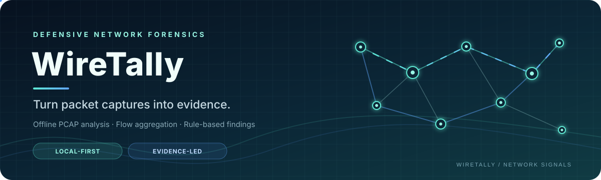

<!-- Animated project banner -->
<p align="center">
  
</p>

<p align="center">
  <a href="LICENSE"></a>
  
  
  
</p>

<p align="center">
  <strong>Turn packet captures into evidence—not guesses.</strong><br>
  A local-first, defensive PCAP/PCAPNG analysis prototype for bidirectional-flow summaries and transparent, rule-based network observations.
</p>

<p align="center">
  <a href="#quick-start">Quick start</a> ·
  <a href="#how-it-works">How it works</a> ·
  <a href="#current-detection-rules">Detection rules</a> ·
  <a href="#security-and-known-limitations">Security & limitations</a>
</p>

---

> **Project status: functional prototype / early MVP.** The repository contains a Python CLI, a FastAPI local endpoint, and a React UI that submits a local PCAP path. This audit reviewed the source files on `main`, but did not execute the project on a separate machine. There is currently no committed automated test suite or GitHub Actions CI workflow, so do not interpret the available source as independently verified or production-ready software.

## At a glance

WireTally reads **PCAP/PCAPNG files you are authorized to analyze**, asks TShark to extract selected packet metadata, groups TCP/UDP packets into bidirectional flows, applies a small set of transparent rules, and writes a JSON report.

It is intentionally metadata-oriented. It does not capture live network traffic, automatically prove an incident, or replace Wireshark, a SIEM, or a trained analyst.

| | Current implementation |
|---|---|
| Input | Local `.pcap` and `.pcapng` files |
| Packet parser | TShark JSON output |
| Flow aggregation | TCP/UDP IPv4/IPv6 metadata where the selected fields are present |
| Rule engine | Two deterministic rules |
| CLI report | Timestamped JSON file |
| Local API | FastAPI endpoint accepting a local file path |
| Web UI | React + TypeScript form and findings view |
| Persistence | No database; reports are local files |
| Automated verification | No committed tests or CI workflow found during this audit |

## Why WireTally?

Packet captures are detailed, but raw packet data is not always the fastest way to start an investigation. WireTally aims to provide a small, repeatable first-pass summary with an explanation for each rule-triggered observation.

### Current capabilities

- **PCAP validation:** checks path existence, regular-file status, extension, empty files, and a configured 100 MiB file-size limit.
- **Metadata extraction:** requests selected frame, IP, TCP/UDP, TCP flag, and DNS query-name fields from TShark.
- **Bidirectional flow aggregation:** aggregates packet counts, total frame bytes, observed start/end timestamps, and TCP flags for a connection key.
- **Rule-based findings:** reports high-volume flows and flows involving a small list of configured ports.
- **JSON evidence report:** stores the capture basename, analysis timestamp, summary counts, and finding evidence.
- **Local API:** exposes `POST /api/v1/analyze` for a local integration.
- **React interface:** accepts a local file path and displays the API's flow/finding summary.

DNS query names are extracted into packet metadata, but the current aggregation and reporting pipeline does **not** publish a separate DNS investigation report. A field being parsed is not the same thing as a completed DNS-analysis feature.

## How it works

~~~mermaid
flowchart TD
    A[Authorized PCAP / PCAPNG] --> B[Capture File Validator]
    B --> C[TShark Metadata Extraction]
    C --> D[Packet Metadata Models]
    D --> E[Bidirectional TCP/UDP Flow Aggregation]
    E --> F[WT-001 / WT-002 Rules]
    F --> G[JSON Report from CLI]
    F --> H[FastAPI Analysis Response]
    H --> I[React + TypeScript UI]
~~~

The CLI is the core analysis path. The web interface currently sends a **filesystem path** to a local API; it does not upload the capture to the server. The API must run on the same trusted computer that can access that path.

## Current detection rules

The rules are intentionally small and explainable. A finding is a lead to investigate, not proof of malicious activity.

| Rule | Current behavior | Severity | Important caveat |
|---|---|---|---|
| `WT-001` — High Volume Data Transfer | Flags a bidirectional flow whose summed packet-frame bytes exceed **10 MiB** | Medium | Legitimate downloads, streaming, backups, and other large transfers can trigger it. It does not distinguish upload from download. |
| `WT-002` — Suspicious Common Ports | Flags a flow whose endpoint ports include `4444`, `3389`, or `6667` | Low | These ports also have legitimate uses. Port presence alone is weak context, not a malware verdict. |

The thresholds and port list are currently hard-coded in `src/wiretally/rules.py`. The rule engine is not a statistical model, threat-intelligence feed, or signature database.

## Quick start

### Requirements

- **Python 3.10 or newer** (the source uses modern Python type syntax).
- **Wireshark/TShark** installed locally and available on `PATH`. On Windows, the CLI also checks common Wireshark installation paths.
- **Node.js and npm** compatible with the Vite version in `web/package-lock.json`, if you want the web UI.
- A sample capture you own, created yourself, or are authorized to analyze.

See the [official TShark manual](https://www.wireshark.org/docs/man-pages/tshark.html) for packet-reader options and supported output formats.

### 1. Check TShark

In PowerShell:

```powershell
tshark --version
```

If PowerShell cannot find `tshark`, install Wireshark with TShark support or add the installation directory to `PATH`. WireTally does not install Wireshark automatically.

### 2. Run the CLI

From the repository root:

```powershell
python --version
python src/wiretally/cli.py "D:\captures\sample.pcap"
```

Replace the example path with a real local capture. When analysis completes, the CLI writes a file named:

```text
wiretally_report_<unix-timestamp>.json
```

The report is written to the current working directory. The current filename uses whole-second timestamps, so repeated runs within the same second may overwrite a report; keep this limitation in mind when running repeated analyses.

### 3. Run the local API

The repository does not yet include a Python dependency manifest. The API requires FastAPI and an ASGI server, so install these in a virtual environment rather than globally where possible.

```powershell
python -m venv .venv
.\.venv\Scripts\Activate.ps1
python -m pip install fastapi uvicorn
python -m uvicorn wiretally.api:app --app-dir src --host 127.0.0.1 --port 8000
```

The service provides:

- `GET /` — a simple service message.
- `POST /api/v1/analyze` — analyze a local capture path.

Example request body:

```json
{
  "pcap_path": "D:\\captures\\sample.pcap"
}
```

The analysis endpoint returns a status, flow count, finding count, and findings. It does not return the CLI's complete timestamped JSON report.

### 4. Run the web UI

Open a second PowerShell terminal at the repository root:

```powershell
cd web
npm ci
npm run dev
```

Open the local URL printed by Vite. Keep the API terminal running as well. The current UI sends a Windows filesystem path to `http://127.0.0.1:8000/api/v1/analyze`; enter a path accessible to the same machine running the API.

## Report shape

The CLI's versioned report currently has this general structure:

```json
{
  "wiretally_version": "0.1.0",
  "schema_version": "1.0",
  "analysis_time": "2026-01-01T12:00:00Z",
  "capture_file": "sample.pcap",
  "summary": {
    "total_flows": 0,
    "total_findings": 0
  },
  "findings": []
}
```

This is a **schema illustration**, not a recorded test output or a benchmark. Real values depend on the capture and the rule results.

## Security and known limitations

These are material limits found by reviewing the current repository source.

### Important security boundaries

- The API has **no authentication or authorization** and accepts an arbitrary local `pcap_path`. Run it only on a trusted machine, bound to `127.0.0.1`; do not expose it to a LAN, the public internet, or untrusted browser origins.
- CORS is configured broadly in the current API. Restrict allowed origins before any broader deployment.
- A file path is processed with the permissions of the local user running the API. The UI does not upload or sandbox files.
- Packet captures can contain internal addresses, identifiers, and sensitive payload-related metadata. Analyze only authorized captures and protect the resulting reports.

### Reliability and analysis gaps

- **No automated tests or CI workflow:** no test suite, Python dependency manifest, or GitHub Actions workflow was present in the repository tree during this audit. Claims of test coverage or CI success would be premature.
- **Resource bounds are incomplete:** the validator caps the input file at 100 MiB, but TShark output is buffered in memory and the subprocess has no explicit timeout. A small compressed/complex capture can still consume substantial resources or run for a long time.
- **Partial parser results can be unclear:** individual packet-normalization exceptions are skipped, and a non-zero TShark exit with non-empty output may still allow processing. Reports do not currently include a skipped-packet count or an explicit completeness state.
- **Narrow flow coverage:** the current aggregation is centered on TCP/UDP flows with usable IP addresses and ports. It is not a complete protocol inventory or full packet-forensics engine.
- **Limited detections:** only WT-001 and WT-002 are implemented. There is no independent DNS rule, scan detector, protocol anomaly model, or threat-intelligence enrichment.
- **DNS findings are not surfaced:** query-name metadata is extracted but is not carried into flow findings or shown in a separate DNS report.
- **Frontend/API security hardening is required:** add server-side path policy, request timeouts, safe error handling, authentication where appropriate, and a restrictive CORS allowlist before considering non-local use.
- **No dependency lock for Python:** add a maintained `pyproject.toml` or requirements file with documented installation and development extras.
- **Generated bytecode is tracked:** `src/wiretally/__pycache__/` contains committed `.pyc` artifacts even though the root `.gitignore` excludes them. Remove those generated artifacts from Git in a code-hygiene commit.
- **Frontend polish and tests remain:** the React app is a simple path-entry/results interface; it does not yet provide packet timelines, flow graphs, filtering, or downloadable report management.

For a defensive-analysis tool, it is better to say “no rule matched” than to claim “the capture is safe.” A clean result only means the current small rule set did not emit a finding.

## Roadmap

### P0 — Make analysis safer and testable

- Add a Python project/dependency manifest and reproducible environment setup.
- Create tests for validation, parser normalization, flow aggregation, rule thresholds, report shape, and API error handling.
- Add synthetic or redistributable PCAP fixtures with documented expected behavior.
- Add subprocess timeouts, process/output safeguards, and explicit incomplete-analysis reporting.
- Restrict API file paths to an approved directory or move to a controlled upload-and-quarantine model.
- Replace broad CORS with a local UI allowlist and document that the API is unauthenticated until authentication is implemented.
- Remove tracked `__pycache__` files from the repository.
- Correct report naming to avoid accidental same-second overwrites.

### P1 — Improve the evidence model

- Surface DNS query metadata in a separately tested report section.
- Include skipped packet counts, parser warnings, and analysis-completeness status.
- Add IPv4/IPv6 and malformed/truncated-capture regression fixtures.
- Make rule thresholds and port lists configurable, documented, and tested.
- Add GitHub Actions for linting and automated tests.

### P2 — Improve the investigation workflow

- Add a flow timeline, protocol/endpoint summaries, search, and finding filters.
- Offer safe report download and report-history handling.
- Add one verified importer for authorized Nmap export data.
- Evaluate performance before introducing any C/C++ component.

Live capture, broad protocol coverage, SIEM integrations, and production deployment are future possibilities—not current features.

## Repository layout

```text
.
├── src/wiretally/
│   ├── cli.py          # CLI entry point and JSON report export
│   ├── api.py          # FastAPI local service
│   ├── validator.py    # Capture path, extension, and size checks
│   ├── parser.py       # TShark metadata extraction
│   ├── models.py       # Packet and flow data models
│   ├── analyzer.py     # Bidirectional flow aggregation
│   └── rules.py        # WT-001 and WT-002
├── web/                # React + TypeScript + Vite interface
├── docs/               # Project state and architecture decisions
├── assets/             # README visual assets
└── LICENSE
```
---

## Creator, Developer & Maintainer

**Created, designed, developed, and maintained by [Nurul Faiyaz](https://github.com/tracolerd).**

This project is independently built and maintained by Nurul Faiyaz. The project's design, implementation, and documentation are his work.

<p align="center">
  <a href="https://www.facebook.com/faiyaz.888"></a>
  <a href="https://www.instagram.com/tracolerd"></a>
  <a href="https://www.linkedin.com/in/faiyaz-xyz"></a>
  <a href="https://x.com/faiyaz_explores"></a>
  <a href="https://github.com/tracolerd"></a>
  <a href="mailto:scrollfaiyaz@gmail.com"></a>
  <a href="https://nurul-faiyaz.netlify.app/"></a>
</p>

<p align="center">
  <a href="https://www.facebook.com/faiyaz.888">Facebook</a> ·
  <a href="https://www.instagram.com/tracolerd">Instagram</a> ·
  <a href="https://www.linkedin.com/in/faiyaz-xyz">LinkedIn</a> ·
  <a href="https://x.com/faiyaz_explores">X / Twitter</a> ·
  <a href="https://github.com/tracolerd">GitHub</a> ·
  <a href="mailto:scrollfaiyaz@gmail.com">Email</a> ·
  <a href="https://nurul-faiyaz.netlify.app/">Website</a>
</p>

## License

MIT. See [LICENSE](LICENSE).